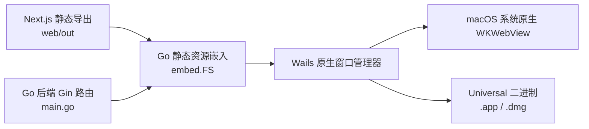

# macOS 桌面本地客户端实现方案 (Wails)

本文档记录如何将本项目打包构建为原生的 macOS 桌面安装包（`.dmg` / `.app`）。

## 一、方案选型与对比

本项目后端采用 Go (Gin + GORM)，前端采用 Next.js (React)。针对此类架构，业界主流的跨平台桌面打包方案对比如下：

| 方案 | 运行机制 | 产物体积 | 内存占用 | 与本项目契合度 |
| :--- | :--- | :--- | :--- | :--- |
| **Wails v2 (推荐)** | **纯 Go 驱动**，macOS 下直接调用系统原生 WebKit (WKWebView) | **约 20MB ~ 30MB** | **极低 (约 50MB~80MB)** | ⭐️⭐️⭐️⭐️⭐️ **原生契合**：后端代码 100% 保持 Go，零额外运行时代价 |
| **Electron** | 内置 Chromium 浏览器 + Node.js 运行时 | 约 120MB ~ 180MB | 高 (约 200MB~400MB) | ⭐️⭐️⭐️ 需额外管理后台 Go 子进程，体积庞大 |
| **Tauri v2** | Rust 驱动调用 WebKit，Go 作为 Sidecar 外部程序 | 约 30MB ~ 40MB | 低 | ⭐️⭐️⭐️ 需额外引入 Rust 工具链与桥接维护成本 |

**结论**：选择 **Wails v2** 作为 macOS 本地客户端打包框架，产物轻巧、原生、同构且维护成本最低。

---

## 二、具体实现架构与步骤

### 1. 架构流转原理



### 2. 前端静态导出适配 (`web/next.config.ts`)

为了让客户端在本地无 Node.js 环境下运行，Next.js 需要配置为静态导出模式：

```ts
// web/next.config.ts
import type { NextConfig } from "next";

const nextConfig: NextConfig = {
  output: "export", // 启用静态导出
  images: {
    unoptimized: true, // 桌面单机环境禁用动态图片优化服务
  },
};

export default nextConfig;
```

执行静态打包：
```bash
cd web && npm run build
# 产物将输出在 web/out 目录中
```

### 3. Wails 启动与服务桥接 (`desktop.go`)

在 Go 根目录下引入 Wails 并桥接现有的 Gin 服务与静态资源：

```go
package main

import (
	"embed"
	"net/http"

	"github.com/wailsapp/wails/v2"
	"github.com/wailsapp/wails/v2/pkg/options"
	"github.com/wailsapp/wails/v2/pkg/options/assetserver"
	"github.com/wailsapp/wails/v2/pkg/options/mac"
)

//go:embed web/out/*
var assets embed.FS

func runDesktop() {
	// 1. 在后台协程启动现有本地 Go Gin 核心服务与 SQLite
	go startLocalServer()

	// 2. 启动 Wails 原生窗口
	err := wails.Run(&options.App{
		Title:  "无限画布",
		Width:  1440,
		Height: 900,
		AssetServer: &assetserver.Options{
			Assets: assets,
		},
		Mac: &mac.Options{
			TitleBar:     mac.TitleBarHiddenInset(), // macOS 原生交通灯风格标题栏
			Appearance:   mac.NSAppearanceNameDarkAqua,
			WebviewIsTransparent: true,
		},
	})
	if err != nil {
		println("Desktop Error:", err.Error())
	}
}
```

### 4. 编译与构建 Universal 二进制安装包

同时适配 Apple Silicon (M1/M2/M3/M4) 和 Intel 架构的 Mac：

```bash
# 1. 安装 Wails 命令行工具
go install github.com/wailsapp/wails/v2/cmd/wails@latest

# 2. 一键打包 macOS Universal 安装包
wails build -platform darwin/universal -package
```

构建完成后，产物将生成在 `build/bin/` 目录下，包含：
- `无限画布.app`
- `无限画布.dmg`（标准的拖拽安装镜像）

---

## 三、macOS 签名与公证机制 (Notarization)

苹果对 macOS 应用有严格的 Gatekeeper 安全检查机制：

### 1. 个人开发 / 开源阶段（无付费开发者证书）
用户初次双击打开未签名的 `.app` 或 `.dmg` 时，系统会提示“已损坏”或“无法打开”。用户只需执行以下任一方式即可运行：
- **方式一（图形界面）**：打开“系统设置” -> “隐私与安全性” -> 找到被拦截的应用，点击“仍要打开”。
- **方式二（终端命令）**：
  ```bash
  xattr -cr /Applications/无限画布.app
  ```

### 2. 正式商业化发布（有 Apple Developer 账号）
在 GitHub Actions CI 流水线中配置自动化签名公证：
1. 配置证书密钥到环境变量：`APPLE_ID`、`APPLE_APP_SPECIFIC_PASSWORD`、`APPLE_TEAM_ID`；
2. 构建后调用 `gon` 工具执行代码签名（Code Signing）与苹果云端公证（Notarization）；
3. 公证通过后，用户下载安装无需任何提示，获得原生丝滑启动体验。
